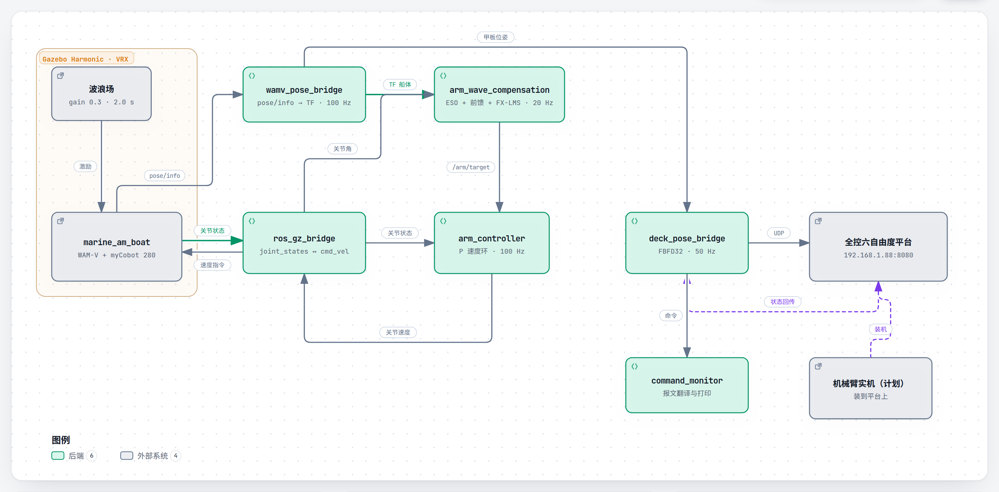
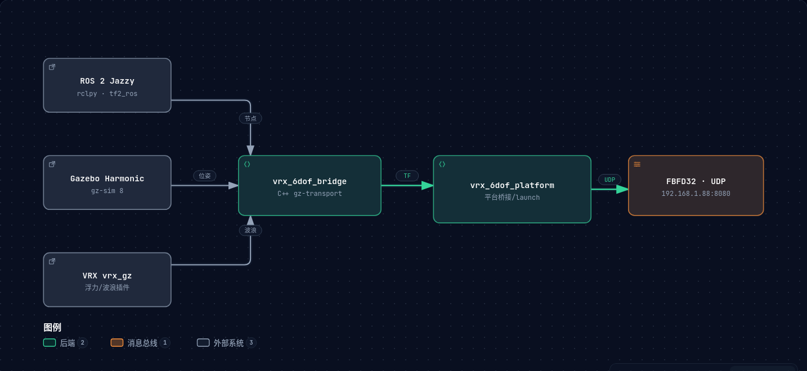

# vrx-6dof-platform

VRX 船体/水体仿真 + 南京全控六自由度平台 FBFD32 桥接。

提供可直接复用的 ROS 2 仿真与平台通信层，供不同上层应用接入：

- Gazebo Harmonic / VRX 船体、波浪、浮力；
- Gazebo 位姿 → TF；
- 甲板位姿 → FBFD32 UDP（默认 `192.168.1.88:8080`）；
- 平台状态回传解析与监听。

## 环境要求

- ROS 2 Jazzy
- Gazebo Harmonic（gz-sim 8）
- VRX（`vrx_gz`，可用 `vcs import src < dependencies.repos` 拉取）
- `ros_gz_bridge`

## 构建

```bash
colcon build --symlink-install
source install/setup.bash
export VRX_6DOF_DIR=$PWD
```

## 启动

```bash
ros2 launch vrx_6dof_platform sim.launch.py
```

常用参数：

```bash
# 无界面
ros2 launch vrx_6dof_platform sim.launch.py headless:=true

# 实际发送 UDP（默认 dry_run:=true）
ros2 launch vrx_6dof_platform sim.launch.py dry_run:=false

# 指定平台地址
ros2 launch vrx_6dof_platform sim.launch.py \
  platform_host:=192.168.1.88 platform_port:=8080
```

## 接口

| 接口 | 说明 |
| --- | --- |
| TF `vrx_smoke_test` → `marine_am_boat` | 甲板/船体位姿 |
| UDP → `platform_host:platform_port` | FBFD32 32 字节位姿指令 |
| `command_monitor` | 解析平台回传状态 |
| `/world/vrx_smoke_test/...` | Gazebo 标准服务与话题 |

## 节点

| 节点 | 作用 |
| --- | --- |
| `wamv_pose_bridge` | gz 位姿 → TF，默认 100 Hz |
| `deck_pose_bridge` | TF → FBFD32 UDP，默认 20 Hz |
| `command_monitor` | 平台回传状态解析 |
| `gz_trail` / `ee_trail` | 可选轨迹可视化 |

## 配置

- `src/vrx_6dof_platform/config/platform_bridge.yaml`：平台地址、端口、dry-run、参考模式；
- 环境变量 `VRX_6DOF_DIR`：指向本仓库根目录，launch 用它定位 `worlds/` 与 `config/`。

## 目录

```text
worlds/                       VRX 世界、船体、波浪模型
src/vrx/                      VRX 源码
src/vrx_6dof_bridge/          Gazebo 位姿桥（C++）
src/vrx_6dof_platform/        平台桥接、监听、launch
docs/diagrams/                Archify 框图源文件与 PNG
```

## 框图




